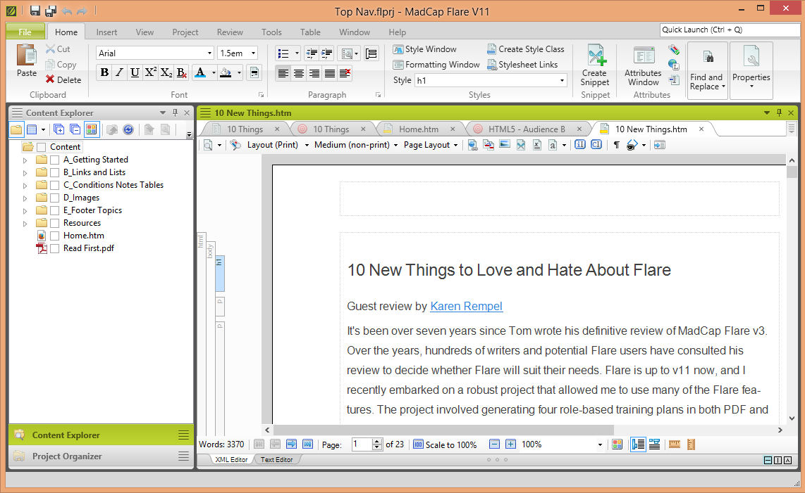

# MadCap Flare Structured Content Publishing Platform

MadCap Flare is a professional authoring environment for creating, managing, and publishing technical documentation from reusable structured content.

It supports topic-based writing, XML authoring, conditional content, variables, snippets, responsive online help, print output, localization, and source-control workflows.

[](https://madcap-flare-2026.github.io/madcap-flare/)

## Overview

madcap flare 2026 represents the current generation of the desktop authoring and publishing workflow described in this repository.

The broader madcap flare platform helps documentation teams maintain one source while delivering content through multiple formats and channels.

Writers can assemble topics into different targets without copying the complete document for every product, audience, region, or release.

| Capability | Purpose | Typical result |
|---|---|---|
| Topic authoring | Divide information into reusable units | Modular documentation |
| Conditional content | Include content by audience or product | Targeted publications |
| Variables | Centralize names and repeated values | Consistent terminology |
| Snippets | Reuse paragraphs and procedures | Reduced duplication |
| Responsive output | Publish browser-based help | Searchable HTML5 sites |
| Print publishing | Produce paginated documents | PDF and Word output |
| Source control | Track and review content changes | Versioned collaboration |
| Localization | Prepare reusable content for translation | Multilingual deliverables |

madcap flare online complements the desktop workflow with hosted projects, reviews, build automation, project tracking, and online publishing services.

## Core Capabilities

madcap flare desktop provides a visual interface for working with source topics, stylesheets, tables of contents, targets, conditions, skins, and project resources.

Key content operations include:

- Authoring technical topics in a structured editor.
- Reusing snippets, variables, images, and shared files.
- Applying conditions for products, versions, and audiences.
- Managing navigation through tables of contents.
- Publishing responsive HTML5 and print-oriented outputs.
- Connecting projects to supported source-control systems.
- Coordinating translation and localization workflows.
- Reviewing generated output before release.


## Single-Source Authoring

Single-source authoring separates maintained information from its final presentation.

A team can write a procedure once, place it in several publications, and vary selected details through conditions or variables.

This model is useful when several products share concepts, interfaces, warnings, configuration steps, or legal notices.

A simplified topic might use semantic XML similar to this independently created example:

```xml
<topic id="publish-project">
  <title>Publish a documentation target</title>
  <body>
    <p>Select the required target and review its conditions.</p>
  </body>
</topic>
```

Actual Flare projects use their own project files, topic conventions, target definitions, and supported markup.

## Content Reuse

Reusable content helps reduce editing effort and prevents related documents from drifting apart.

| Reuse method | Best suited for |
|---|---|
| Topic reuse | Complete concepts, tasks, and reference pages |
| Snippets | Repeated notes, warnings, or short procedures |
| Variables | Product names, versions, dates, and organization names |
| Conditions | Audience-specific or platform-specific variants |
| Master pages | Shared print layout and repeated page elements |
| Stylesheets | Consistent typography and responsive presentation |

Content reuse works best when each topic has a clear purpose and minimal dependence on its original publication context.

Writers should review reused material in every important output because navigation, conditions, and surrounding topics can change its meaning.

## Multi-Channel Publishing

A Flare project can define several targets from the same maintained source.

Common publishing destinations include:

- Responsive HTML5 help sites.
- Searchable product documentation portals.
- PDF manuals and printable guides.
- Microsoft Word documents.
- ePub content.
- Knowledge bases and support systems.
- Learning and training materials.
- Internal policy or process documentation.

Targets can apply different tables of contents, conditions, styles, skins, output folders, and publishing destinations.


## Responsive HTML5

Responsive HTML5 output adapts navigation and content presentation for desktop, tablet, and mobile screens.

A documentation team can configure branding, search, menus, breadcrumbs, feedback controls, and other presentation elements through project resources.

Generated sites can be published to a web server or connected platform according to the organization's release process.

Analytics and feedback integrations can help teams identify popular searches, failed searches, frequently visited pages, and content gaps.

## Print and PDF Output

Print targets assemble topics into a paginated document with controlled headings, page breaks, headers, footers, numbering, and cross-references.

Stylesheets and page-layout resources keep visual decisions separate from most source content.

Before release, teams should inspect:

- Page and chapter breaks.
- Table width and image scaling.
- Generated cross-references.
- Index and glossary entries.
- Conditional text.
- Font embedding.
- Accessibility and metadata.
- Language-specific layout behavior.

## Structured Publishing Reference

The local source collection contains build files from DITA Open Toolkit, a separate open-source structured publishing engine.

These files provide architectural examples for automated XML publishing and are not the proprietary source code of MadCap Flare.

The root [build.gradle](build.gradle) defines Java, publishing, signing, formatting, dependency, and distribution tasks.

[settings.gradle](settings.gradle) registers format-specific subprojects such as HTML5, HTML Help, and PDF processing.

The project version, Java compatibility, repositories, plugins, and distribution behavior are coordinated through Gradle.

This structure illustrates how a publishing engine can separate shared processing from output-specific modules.

## Build Automation Reference

The supplied [gradlew](gradlew) launcher runs Gradle tasks on POSIX-compatible systems.

Windows environments use the corresponding [gradlew.bat](gradlew.bat) launcher.

For example, this command requests the distribution task from the downloaded reference project:

```powershell
.\gradlew.bat dist
```

The command applies to the DITA Open Toolkit reference files, not to a MadCap Flare project or Flare build target.

The wrapper configuration in [gradle-wrapper.properties](gradle/wrapper/gradle-wrapper.properties) selects the required Gradle distribution and network settings.

[gradle-wrapper.jar](gradle/wrapper/gradle-wrapper.jar) contains the binary wrapper bootstrap used by both launchers.

Distribution assembly and dependency notices are coordinated by [dist.gradle](gradle/dist.gradle).

## Container Publishing Reference

The included [Dockerfile](Dockerfile) defines a Java-based container for the reference publishing engine.

It accepts a release version as a build argument, retrieves that distribution, prepares runtime directories, and exposes the publishing command through the container path.

A compatible reference image can be constructed with a command such as:

```bash
docker build --build-arg VERSION=4.4.0 -t structured-publishing-reference .
```

The selected version must exist in the referenced project's release archive.

Containerized builds can help documentation teams keep publishing dependencies consistent across workstations and automation services.

Flare build automation uses Flare-supported desktop, command-line, source-control, or Flare Online workflows instead of this DITA container definition.

## Source Control and Collaboration

A documentation project benefits from small, reviewable changes and clear ownership of shared resources.

Recommended practices include:

1. Separate source edits from generated output.
2. Review condition changes with every affected target.
3. Use meaningful commit messages for content and configuration updates.
4. Resolve XML conflicts carefully rather than accepting entire files blindly.
5. Validate links, variables, snippets, and navigation before publishing.
6. Tag or archive the exact source used for an important release.

Source-control integration can support parallel authoring, review history, branching, release maintenance, and rollback.

Flare Online can add browser-based review and hosted project services to a team workflow.

## Localization

Structured reuse can reduce translation volume when the same approved source appears in several outputs.

Localization planning should account for:

- Text expansion and contraction.
- Language-specific fonts.
- Right-to-left presentation.
- Translated variables and snippets.
- Conditional content.
- Image text and callouts.
- Index sorting.
- Search tokenization.
- Review ownership and translation memory.

Writers should avoid embedding product values directly in sentences when a managed variable can express them consistently.

## AI-Assisted Documentation

AI features can help with drafting, revision, summarization, and content discovery when governed by an editorial process.

Human reviewers should verify technical accuracy, product terminology, prerequisites, warnings, links, and version-specific instructions.

Structured topics and micro-content can also make approved information easier to index for search, chatbots, and retrieval systems.

AI-generated material should follow the same review, localization, accessibility, and source-control rules as manually written content.

## Project Governance

A maintainable project needs conventions for filenames, topic types, folders, metadata, conditions, variables, and target ownership.

Teams should document:

- Which target publishes each deliverable.
- Who approves shared snippets and variables.
- How obsolete topics are retired.
- Which branches represent supported releases.
- How output is validated.
- Where translations and reviews occur.
- Which integrations receive published content.

Governance prevents convenience changes in one target from unexpectedly affecting other publications.



## Compatibility and Scope

MadCap Flare is commercial software developed by MadCap Software.

Features, licensing, output formats, integrations, and cloud services can vary by product edition, subscription, release, and purchased components.

The reference source files in this repository demonstrate concepts from an independent XML publishing project.

They do not provide the Flare application, a Flare license, MadCap services, or an implementation of proprietary Flare features.

## Licensing

The reference build collects notices for the components included in its distribution.

The [apache2.txt](gradle/apache2.txt) notice covers dependencies distributed under Apache License 2.0 terms.

The [bsd-jing.txt](gradle/bsd-jing.txt) and [bsd-flexmark.txt](gradle/bsd-flexmark.txt) files document BSD-licensed components.

XML processing includes the notice stored in [sax.txt](gradle/sax.txt).

Standards-related notices are provided for [oasis-dita20.txt](gradle/oasis-dita20.txt), [oasis-dita13.txt](gradle/oasis-dita13.txt), and [oasis-lwdita.txt](gradle/oasis-lwdita.txt).

These notices apply to the downloaded reference project and should not be interpreted as licensing terms for MadCap Flare.

Review the applicable MadCap agreement before using the commercial software, services, templates, or bundled content.

## Related Search Terms

madcap flare 2026, madcap flare, madcap flare online, madcap flare desktop, madcap flare software, technical-writing, documentation, xml, single-source-publishing, content-reuse, responsive-html5, technical-documentation, localization, source-control, documentation-tool
